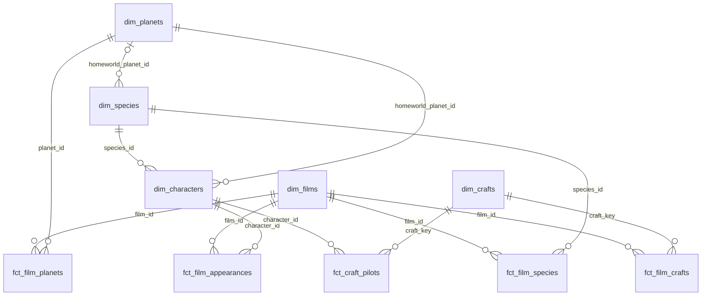

# Data model

Target model for the dbt project. It turns the six `raw.*` tables (see [ingestion.md](ingestion.md)) into a Kimball-style star schema that the dashboard reads. This is the design reference. Once the dbt YAML exists, column-level docs live there (`dbt docs generate`) and this file keeps only the decisions behind them.

```
raw (JSON doc per record) ──► staging (flatten, type, clean; 1:1) ──► marts (dims + keys-only facts) ──► reporting (aggregates) ──► dashboard
```

## 1. Profiling facts the design relies on

Checked against the `swapi.dev` load (people 82, planets 60, films 6, species 37, starships 36, vehicles 39).

| Finding | Consequence |
|---|---|
| Every record has a `url` ending in `/<int>/`, and the integer is unique per resource | The integer is the natural key (`<entity>_id`) |
| Starship IDs (2–75) and vehicle IDs (4–76) never overlap, as if they share one ID sequence | Starships and vehicles are combined into one craft dimension, but the key includes `craft_type` so the design does not depend on the IDs staying disjoint |
| Each relationship is stored on both sides (e.g. `films.characters` and `people.films`), and both sides match exactly for all 9 relationships | Each fact is built from one side only. A test checks that the other side still matches |
| No dangling URL references | Relationship tests should pass from day one, so any failure means real drift |
| `people.species` has 0 or 1 entries (32 people have none, including Luke, Han and Leia) | `species_id` is a single foreign key on the character, not a many-to-many fact. A test enforces that there is at most 1. Missing values go to the unknown member and are **not** filled in as Human |
| 72 of 162 film appearances are by characters with no species | Species-diversity results come with a stated coverage figure |
| Planet 28 is a placeholder (`name = 'unknown'`, 5 residents, Yoda's species) | Mapped to the unknown member `-1` (see §5) |
| `species.homeworld` is NULL for Droid | Allowed: a NULL homeworld on a species is valid |
| `films.species` differs from the species of the film's characters (10 pairs only in the film list, 9 only from characters) | Both are kept, but as separate concepts (§6) |
| Three distinct missing-value meanings: `unknown` (exists but not known), `n/a` (does not apply, e.g. droid gender), `none` (truly zero/absent, e.g. bald, no cargo) | `unknown`/`n/a` → NULL; `none` → `0` for numbers and is kept as a real value for categories |
| Numbers with commas (`1,358`, `47,060`), units (`1000km`), ranges (`30-165`), trailing spaces (`36.8 `) | Parsing rules in §4. A test makes sure no value is turned into NULL without notice |
| `planets.diameter = 0` for 6 planets (some inhabited, e.g. Trandosha) | 0 is the source's stand-in for unknown. Staging keeps it and warns; `dim_planets` turns it into NULL |
| Category typos: `Galatic Basic`, `mammals`/`mammal`, `blonde`/`blond`, `air speeder`/`airspeeder`, `Star Destroyer`/`star destroyer` | Normalised in staging (§4) |
| Text is valid UTF-8 (`Padmé`, `Cordé`) | No re-encoding. If names look garbled, that is the PowerShell console |

## 2. Design principles

1. **Raw is never modified.** All cleaning happens in dbt, so every value can be traced back to `raw` with `loaded_at` and `source_system`.
2. **One job per layer.** Staging cleans values and changes no rows. Marts hold conformed dimensions (attributes only), keys-only facts (the unnested relationships) and unknown members. Reporting models hold the aggregates (counts, flags over many rows) and derive them from the facts, so a number exists in one place. There is no intermediate layer: nothing is shared between marts that is not already a fact (§6).
3. **Every model has a stated grain** and a tested primary key.
4. **Facts never have NULL foreign keys.** Missing references point to an unknown member (`-1`). A link from one dimension to another (e.g. a species' homeworld) may be NULL.
5. **No invented data.** Missing values stay missing (or become the unknown member). Nothing is imputed.
6. **No silent data loss.** Any value that is not a recognised missing-value marker but still fails to parse makes a test fail.
7. **Column names carry their units** (`_cm`, `_kg`, `_km`, `_kmh`, `_hours`, `_days`, `_credits`). Booleans start with `is_`/`has_`, timestamps end in `_at`, and foreign keys are named by role (`homeworld_planet_id`).
8. **Business names in marts.** The source's `people` becomes `characters`, and starships and vehicles become `crafts`.
9. **Dimensions describe, facts record, reports aggregate.** A dimension holds attributes of one entity (a row-level derived value such as BMI is fine). A count over other rows (`film_count`, `resident_count`) is not an attribute, so it lives in a reporting model. A fact holds keys (and measures) only and copies no dimension attribute.
10. **One home per business rule.** For example, "a missing or placeholder planet becomes the unknown member" is the macro `resolve_planet_id`, which every mart calls.

## 3. Layers, schemas, materialisation

| Layer | Schema | Materialised as | Reads | Rule |
|---|---|---|---|---|
| sources | `raw` | tables (ingestion) | n/a | Declared in `sources.yml`. Each table is `(doc JSON, _loaded_at, _source)`: the whole record in one JSON column. Freshness is checked on `_loaded_at` |
| staging | `staging` | view | one source | Rename, cast, missing markers → NULL, parse units, extract IDs. Same row count as the source |
| marts | `marts` | table, contract enforced | staging | Dimensions (attributes only) and keys-only facts. The facts unnest the `*_urls` arrays. Never reads another mart |
| reporting | `marts` (folder `models/reporting`) | table, contract enforced | marts + staging | `rpt_*` aggregates over facts and dimensions. The dashboard reads these and the dimensions |

Override `generate_schema_name` so the schemas are named exactly `staging`/`marts` rather than `main_staging`. Marts are tables so the dashboard does not re-run view logic, and so a dashboard holding a read lock does not get in the way of `dbt build`.

## 4. Staging rules

### Applies to every model

- **Flatten:** every field is read from the JSON column with `doc ->> 'field'` (text), `cast(...)` (typed fields) or the `json_array` macro (`VARCHAR[]`). Typed casts (`episode_id`, `release_date`, `created`/`edited`) are plain `cast`, not `try_cast`, so a changed source type fails the build instead of being hidden. A removed field becomes NULL.
- `<entity>_id = cast(regexp_extract(url, '/([0-9]+)/?$', 1) as integer)` through a macro `extract_id(col)`. The same macro is used for foreign-key URLs and array items.
- Text: `trim()`. Missing markers: `lower(trim(x)) in ('unknown', 'n/a', '')` → NULL, via a macro `clean_null(col)`.
- Numbers: `try_cast(replace(trim(x), ',', '') as <type>)` after `clean_null`, via a macro `to_number(col, type)`.
- `created`/`edited` → `source_created_at`/`source_edited_at`. `_loaded_at`/`_source` → `loaded_at`/`source_system`.
- URL arrays are carried through unchanged as `*_urls` for the facts, which unnest them. They are not exposed in dimensions.

### Column-specific rules

| Model.column | Raw example | Clean column(s) | Rule |
|---|---|---|---|
| people.height | `172`, `unknown` | `height_cm` int | standard number |
| people.mass | `1,358` | `mass_kg` double | comma removed |
| people.birth_year | `41.9BBY` | `birth_year_bby` double | BBY → positive, ABY → negative (none in the data today) |
| people.gender | `n/a`, `none` | `gender` | `n/a`/`none` → NULL. Accepted: `male`, `female`, `hermaphrodite` |
| people.hair_color | `none`, `n/a`, `blonde` | `hair_color` | `n/a` → NULL. `none` is kept (means bald). `blonde` → `blond` |
| people.species | `[url]` / `[]` | `species_id` int | `extract_id(species[1])`. A test asserts `len(species) <= 1` |
| planets.population | `2000000000` | `population` bigint | max is 1e12, which fits in bigint |
| planets.gravity | `1.5 (surface), 1 standard (Cloud City)` | `gravity_g` double, `gravity_desc` | first number in the text. Original text kept |
| planets.rotation/orbital_period, diameter, surface_water | | `rotation_period_hours`, `orbital_period_days`, `diameter_km`, `surface_water_pct` | standard number |
| planets.climate, terrain | `temperate, arid` | `climates`, `terrains` varchar[] | split on `,`, trim, lowercase. Lists are fine for filtering. No separate dimension because no question needs one |
| planets (name = `unknown`) | | `is_placeholder` bool | true for the placeholder record |
| species.classification | `mammals`, `reptilian` | `classification` | lowercase. `mammals` → `mammal`, `reptilian` → `reptile` |
| species.designation | `reptilian` (1 row) | `designation` | kept as is. Flagged as a likely source error |
| species.language | `Galatic Basic` | `language` | typo and casing fixed to `Galactic Basic` |
| species.average_lifespan | `indefinite` | `average_lifespan_years` int, `is_lifespan_indefinite` bool | `indefinite` is a real value, not missing |
| species.average_height | `n/a` | `average_height_cm` int | standard number |
| starships/vehicles.cost_in_credits | `1000000000000` | `cost_credits` bigint | standard number |
| .length | `1,600`, `36.8 ` | `length_m` double | comma removed and trimmed |
| .max_atmosphering_speed | `1000km` | `max_atmosphering_speed_kmh` int | digits before the `km` suffix |
| .crew | `30-165`, `47,060` | `crew_min`, `crew_max` int | a range is split into min and max; a single value sets both |
| .passengers | `843,342`, `n/a` | `passengers` int | standard number |
| .cargo_capacity | `none` | `cargo_capacity_kg` bigint | `none` → 0 |
| .consumables | `2 months`, `Live food tanks` | `consumables_days` double, `consumables_desc` | `<n> hour/day/week/month/year` → days (1/24, 1, 7, 30, 365). `0`/`none` → 0. Anything else → NULL with the text kept |
| starships.hyperdrive_rating, MGLT | `2.0` | `hyperdrive_rating` double, `mglt` int | standard number |
| starship_class / vehicle_class | `Star Destroyer`, `air speeder` | `craft_class` | lowercase. `air speeder` → `airspeeder` |
| .manufacturer | `Gallofree Yards, Inc.` | `manufacturer` | kept as one text value. It is **not** split on commas, because commas also appear inside names (`Inc.`) |
| films.producer | `Gary Kurtz, Rick McCallum` | `producers` varchar[] | split on `,` (no commas inside these names) |

The value fixes are a short, known list, so they are written as `case` expressions in staging. If the list grows past about 10 entries, move it to a seed file (`seed_value_mappings.csv`: column, raw value, clean value) so the fixes are data that can be reviewed.

## 5. Keys and unknown members

| Dimension | Primary key | Type | Why |
|---|---|---|---|
| `dim_films`, `dim_characters`, `dim_planets`, `dim_species` | `<entity>_id` | SWAPI integer | There is one source, the IDs never change, and the history is Type 1, so a surrogate key adds nothing yet |
| `dim_crafts` | `craft_key` | `md5(craft_type || '|' || source_craft_id)` | Two ID ranges combined into one dimension. The disjoint IDs are an observation, not a guarantee |

Unknown members are added in marts, not staging, so staging still reflects the source exactly:

- `dim_species` gets the row `species_id = -1, name = 'Unknown'`. People with no species → `-1`.
- `dim_planets` gets the row `planet_id = -1, name = 'Unknown'`. References to the placeholder planet 28 and NULL references both → `-1` (macro `resolve_planet_id`, used by `dim_characters` and `dim_species`). Planet 28 is not loaded into `dim_planets`, so "unknown" is represented by one row only. Staging keeps planet 28 so it can be traced back.
- Unknown members never count towards measures (`is_unknown_member = true` is excluded from counts and averages). Their attributes are NULL, not made-up values (for example `is_lifespan_indefinite` is NULL for the unknown species).

## 6. Mart model



### Facts

Every many-to-many relationship in SWAPI is one fact. There is no separate bridge layer: the fact is the unnested array.

| Model | Grain | Built from | Keys | Expected rows |
|---|---|---|---|---|
| `fct_film_appearances` | one row per character per film | `films.characters` | `film_id`, `character_id` | 162 |
| `fct_film_planets` | one row per planet listed on a film | `films.planets` | `film_id`, `planet_id` | 33 |
| `fct_film_species` | one row per species listed on a film | `films.species` | `film_id`, `species_id` | 73 |
| `fct_film_crafts` | one row per craft listed on a film | `films.starships` ∪ `films.vehicles` | `film_id`, `craft_key` | 104 |
| `fct_craft_pilots` | one row per pilot per craft | `people.starships` ∪ `people.vehicles` | `character_id`, `craft_key` | 43 (30 starship, 13 vehicle) |

All five are factless (keys only, no measure), unique on their two keys, and built from staging without reading any dimension. Species, homeworld and release date are reached through `dim_characters` and `dim_films`, and the craft type through `dim_crafts`. An orphaned key therefore fails a `relationships` test instead of being dropped by a join.

**Why there is no intermediate layer.** The five unnest models that used to sit between staging and the facts were identical to the facts: each was a bare `unnest` of one staging column with one consumer. An intermediate model earns its place when several models reuse it or when its logic is non-trivial, and neither applied. Keeping them meant two models and two sets of tests per relationship for no extra behaviour. If a relationship ever needs shared, non-trivial logic (for example a second source), reintroduce a model for that one.

**Why the placeholder planet is not mapped in `fct_film_planets`.** `dim_characters` and `dim_species` use `resolve_planet_id` because a missing homeworld is a normal case that points to the unknown member. A film listing a planet is a different statement: "an unknown planet appears in this film" is meaningless, so if the placeholder ever shows up the `relationships` test fails instead of hiding it. It does not appear today.

### Dimensions

| Model | Grain | Notable columns (beyond the cleaned staging columns) |
|---|---|---|
| `dim_films` | film | `episode_id` (unique, 1–6), `release_order`, `trilogy` (`prequel`/`original`) |
| `dim_characters` | character | `homeworld_planet_id`, `species_id`, `species_name` (denormalised, so reports need no join), `bmi` (= `mass_kg / (height_cm/100)^2`, only when both are present), `is_droid` |
| `dim_planets` | planet + unknown member | `climates`, `terrains`, `is_unknown_member` |
| `dim_species` | species + unknown member | `homeworld_planet_id` (nullable), `is_lifespan_indefinite`, `is_unknown_member` |
| `dim_crafts` | craft (starship or vehicle) | `craft_type`, `source_craft_id`, `craft_class`, shared transport columns. `hyperdrive_rating` and `mglt` are filled only for starships |

Starships and vehicles are combined because they share 10 attributes (the starship-only ones are `hyperdrive_rating`, `MGLT` and the class) and play the same role as "crafts" in films and for pilots. The alternative was two dimensions and two craft facts each; it was rejected because it doubles the models and the joins for every craft question. Columns that only apply to starships are NULL for vehicles, and `craft_type` filters them.

### Reporting models

| Model | Grain | Columns |
|---|---|---|
| `rpt_planet_residents` | planet + unknown member | `population`, `resident_count` (characters with this homeworld) |
| `rpt_character_film_summary` | character | `film_count`, `is_in_all_films` |
| `rpt_film_summary` | film | `character_count`, `planet_count`, `species_count_listed`, `craft_count` |

These replace the count columns that used to sit in the dimensions. Per-species, per-craft and per-planet film counts were dropped because no question used them; they are one `group by` on the facts if needed.

### Film species: listed vs observed

- **Listed** (`fct_film_species`, from `films.species`): what the source says appears in the film. Used for `rpt_film_summary.species_count_listed`.
- **Observed** (`fct_film_appearances` joined to `dim_characters.species_id`): the species of the named characters. Used for diversity analysis and always shown with the share of appearances whose species is unknown (72 of 162 today).

The two are not merged, because they answer different questions and differ in the source.

## 7. Two-way relationships

SWAPI states each relationship on both sides. Each fact is unnested from one canonical side (the table above). A singular test per fact (`tests/fct_*_two_way_match.sql`) checks that the opposite side still lists exactly the same pairs (§8).

## 8. Testing strategy

| Level | Tests |
|---|---|
| Sources | `doc` not_null. `freshness` on `_loaded_at`. Uniqueness of the record `url` is tested on the staging primary keys |
| Staging | PK unique + not_null. `accepted_values` (gender, craft_type, trilogy). Generic `positive_value` test (height, mass, length, diameter). **Parse-completeness** test: a raw value that is not a missing marker but parses to NULL fails, so a `try_cast` cannot drop data unnoticed. `len(people.species) <= 1` |
| Marts | PK unique + not_null. Every fact is unique on its two keys, and every fact FK has `relationships` to its dimension and is never NULL. **Two-way match** singular tests: each fact equals its inverse (e.g. `films.characters` vs `people.films`), which catches API drift where one side is updated. Row counts match raw (e.g. `fct_film_appearances` = `sum(len(films.characters))`). Exactly one unknown member per dimension. Model contracts (`contract: enforced: true`) fix the column names and types the dashboard depends on. Unit tests cover BMI, the unknown members, the placeholder planet and the starship/vehicle key |
| Reporting | PK unique + not_null. A singular test reconciles every total with an independent source (residents = characters, film counts = the arrays on the films). A unit test covers `is_in_all_films` |

## 9. Model inventory

19 models: 6 staging, 10 core marts (5 dimensions, 5 facts), 3 reporting. That is above the plan's 12–15. The 6 staging models are required (one per source), combining starships and vehicles already saves 3 models, and dropping the intermediate layer saves 5 more. The 3 film facts that feed only `rpt_film_summary` can be dropped if time runs short, at the cost of the integrity tests and film counts they feed.

| Layer | Models |
|---|---|
| staging | `stg_films`, `stg_people`, `stg_planets`, `stg_species`, `stg_starships`, `stg_vehicles` |
| marts | `dim_films`, `dim_characters`, `dim_planets`, `dim_species`, `dim_crafts`, `fct_film_appearances`, `fct_film_planets`, `fct_film_species`, `fct_film_crafts`, `fct_craft_pilots` |
| reporting | `rpt_planet_residents`, `rpt_character_film_summary`, `rpt_film_summary` |
| macros | `extract_id`, `clean_null`, `to_number`, `resolve_planet_id`, `craft_key`, `generate_schema_name` |

## 10. Questions → marts

| Question | Reads | Caveat |
|---|---|---|
| Film with the most characters, and its species diversity | `rpt_film_summary`, and `fct_film_appearances` + `dim_characters` for the observed species | Show the share of appearances with unknown species |
| Home planets with the most characters relative to population | `rpt_planet_residents` (`resident_count`, `population`) | Exclude the unknown member and NULL population |
| BMI by species | `dim_characters` (`species_name`, `bmi`) | Jabba (BMI ≈ 443) is a real value, not an error. Flag it, don't drop it |
| Starship cost vs hyperdrive rating | `dim_crafts where craft_type = 'starship'` | 10 of 36 starships have an unknown cost |
| Characters in all films | `rpt_character_film_summary.is_in_all_films` | C-3PO, R2-D2, Obi-Wan Kenobi |

## 11. Production evolution

- **History:** move from Type 1 to Type 2 with `dbt snapshot` keyed on `edited`. Dimensions then switch to hashed surrogate keys with `valid_from`/`valid_to`, and facts look up the version valid at the time.
- **Incremental:** append-only raw tables with `_loaded_at`. Staging keeps the latest version per ID (`qualify row_number() over (partition by id order by edited desc) = 1`), and marts use `incremental` materialisation with `unique_key`.
- **Multiple sources:** a `source_system` column in every key's hash, plus a conformed ID mapping if a second Star Wars source is added.
- **Value mappings** move to a seed or a reference table owned by the data stewards.
- **Contracts and versions** on marts (`versions:` in dbt) so dashboard consumers can migrate when a column changes.
